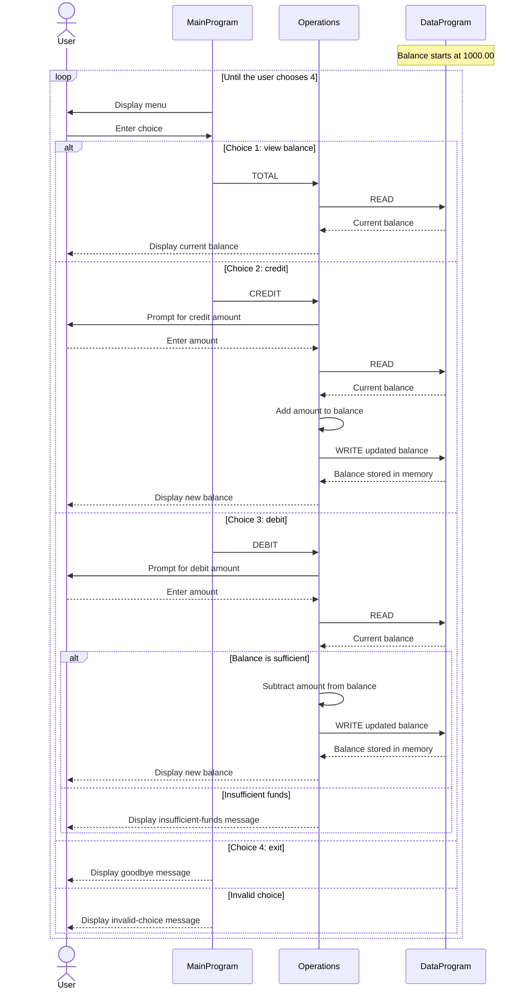

# COBOL Account Management System

This directory documents the COBOL account-management application in
[`src/cobol/`](../src/cobol/). The program provides a console menu for viewing
one account's balance, crediting it, and debiting it. Its balance is held in
memory while the program runs.

## COBOL programs

### `main.cob` — `MainProgram`

Entry point and user interface. It repeatedly displays the account menu,
accepts a choice, and dispatches the corresponding operation:

- `1` calls `Operations` with `TOTAL ` to display the balance.
- `2` calls `Operations` with `CREDIT` to credit the account.
- `3` calls `Operations` with `DEBIT ` to debit the account.
- `4` exits the menu and ends the program.

Other inputs display an invalid-choice message and return to the menu.

### `operations.cob` — `Operations`

Implements the account actions and interacts with `DataProgram`:

- `TOTAL ` requests the stored balance and displays it.
- `CREDIT` prompts for an amount, reads the current balance, adds the amount,
  writes the updated balance, and displays it.
- `DEBIT ` prompts for an amount and reads the current balance. If the balance
  is sufficient, it subtracts the amount, writes the updated balance, and
  displays it; otherwise, it displays an insufficient-funds message without
  updating the balance.

Amounts and balances use `PIC 9(6)V99` fields (six integer digits and two
implied decimal places).

### `data.cob` — `DataProgram`

Stores the account balance and provides the read/write interface used by
`Operations`. The balance starts at `1000.00`. A `READ` operation copies the
stored balance to the caller; a `WRITE` operation copies the caller's balance
into storage. The storage is working storage, so this program does not save
the balance to durable storage.

## Student account business rules

- The account starts with a balance of **1000.00**.
- A credit adds the entered amount to the balance.
- A debit is allowed when the balance is greater than or equal to the entered
  amount. Otherwise, it is rejected as insufficient funds and the balance is
  unchanged.
- The code does not explicitly validate that entered amounts are positive.
- The balance is kept in program memory and is not retained after the program
  exits.

## Application data flow

